# “The fearful fox”

Cyber Physical Systems project.

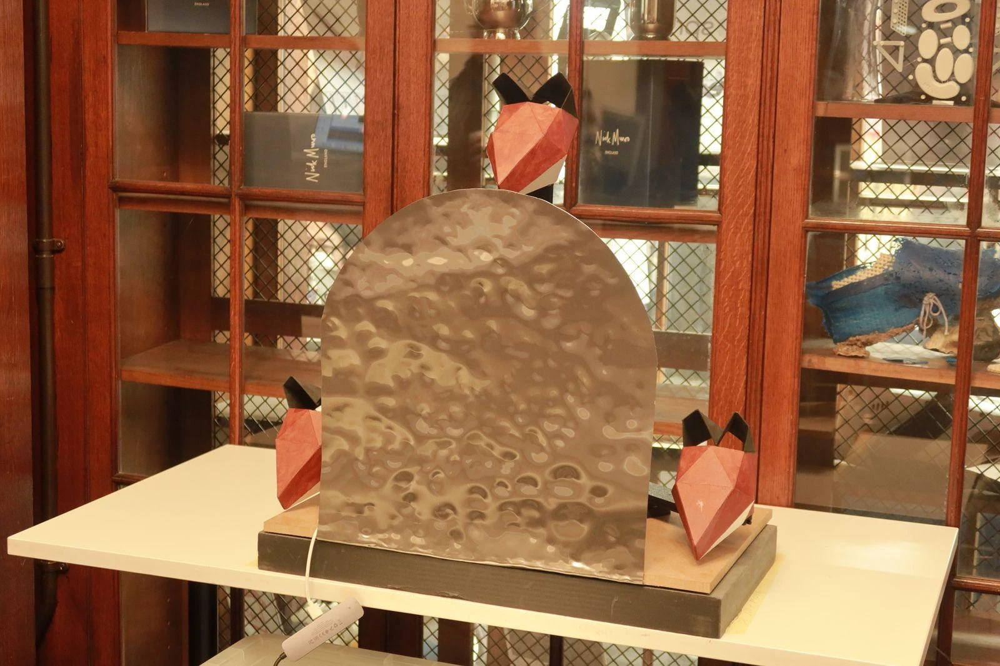

[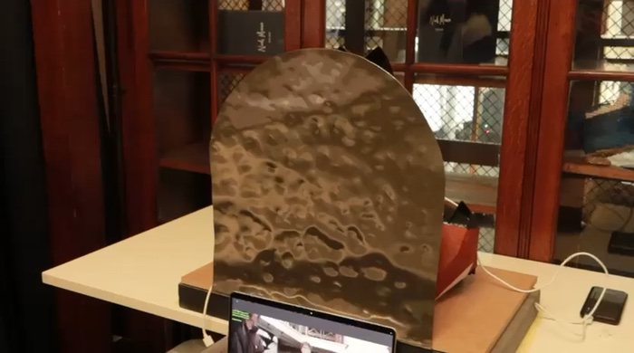](videos/demo.mp4)

Demo video (click to download video).

## Philosophy

“A study of 18 samples at the University of Wolverhampton found that urban fox scat contained 135 dangerous artificial chemicals from 17 of the scats, including some which have likely originated from consumption of discarded cigarette ends and petrol.” [ https://mammal.org.uk/british-mammals/red-fox]

Foxes are survivors, adapting their omnivorous desires to the environment they inhabit, including London itself. Due to their adaptability and survivability; however, we take their existence for granted. The existence of humans on earth, especially in urban areas, never fails to lack consideration for the impact of the other species that inhabit the same planet. We walk through these spaces as animals retreat simply from the result of our presence, knowing that our existence historically and inherently is threatening. How do we consider our impact on their lives, when the built environment we collectively inhabit is constructed to ignore and exclude them?

The relationship between urban fox and urban human is reflective of the relationship humans have with many other animals in the world. The approaching presence of a person causes a fox to scatter or hide. We've made ourselves untrustworthy.

“The Fearful Fox” is a piece designed to explore these issues.

## How it behaves

The fox is represented with 3 fox heads. Three heads sit behind a metal plate, one on each side and one at the top, and respond to where and how a human approaches. When a person stands close, the fox hides. At a medium distance away, a head peeks out and retreats. Far away, a head comes out and stays for a bit before retreating. The fox will always appear away from the visitor, as it is timid. If a person stands to the left of the metal plate, a fox head will appear on the right. If they stand to the right, it will appear on the left, and if they stand central to the plate it will appear above the plate. To coax the fox out, the person must hold their hand out as if offering food. Holding a hand out while close brings out the fox head on the side the visitor stands. An empty room is treated as no human present (far away).

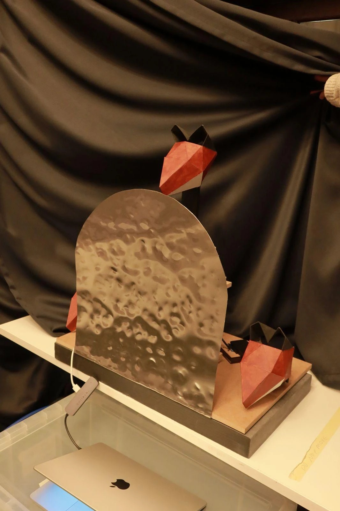

## Mechanical design

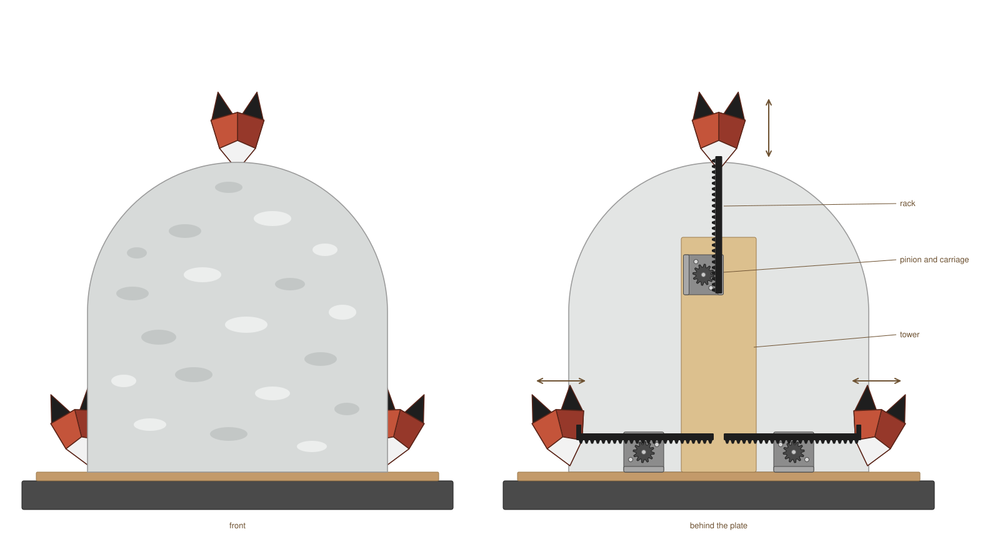

Each head is on its own rack and pinion. A stepper motor turns the pinion, and the rack slides the head out from behind the plate and back. The three units share one printed design: a mount plate (3) holding the motor (1), the pinion (2) on the motor shaft, a rack (4) running past it between two side posts, and the head at the end of the rack. The side heads slide along the base and the top head rises on a vertical tower.

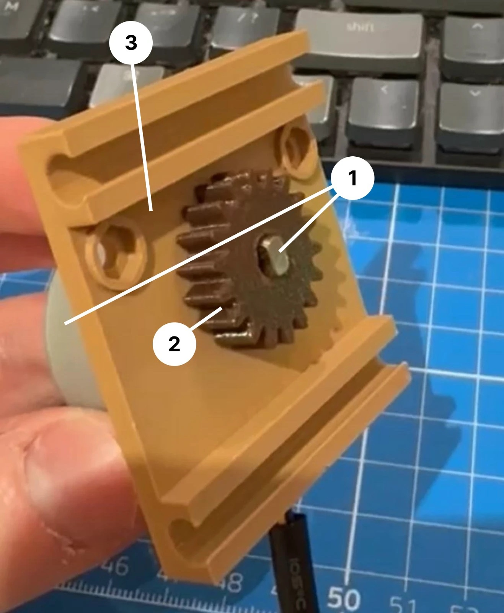

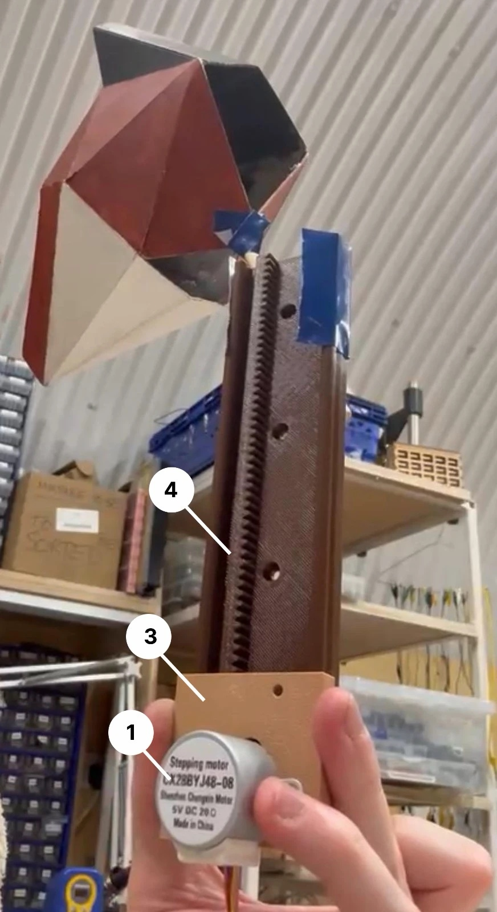

The CAD files are in the cad folder.

The side heads travel about 900 steps (the motors make 2048 steps per turn). The top head travels about 4800 to 5000 steps because the motor is slower. Every move runs its first and last 100 steps at a lower speed to avoid jerking.

We planned the layout in paper at full size before modelling it, to find the travel each head needed.

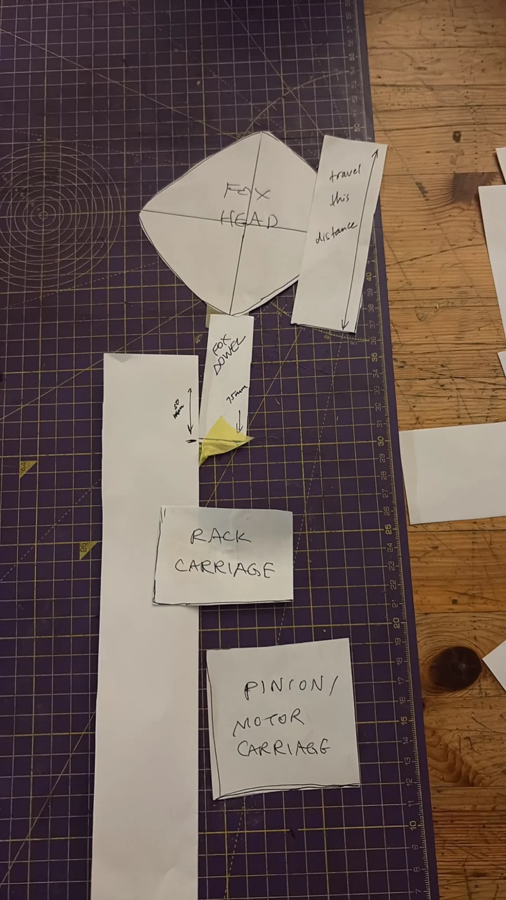

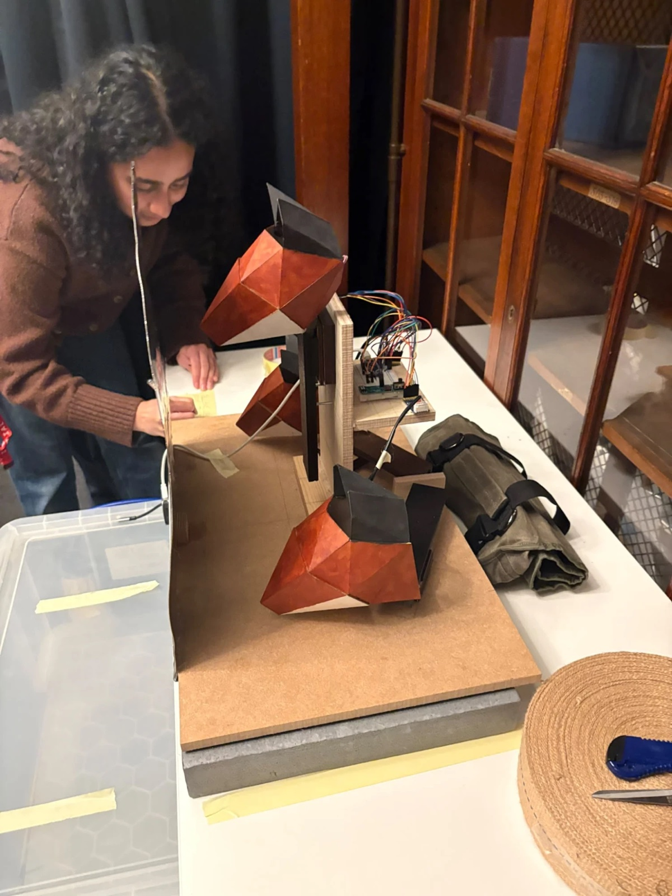

The plate is sheet metal cut to an arch and hammered to catch the light. It hides the racks, motors and electronics from the front. The heads are folded and painted card.

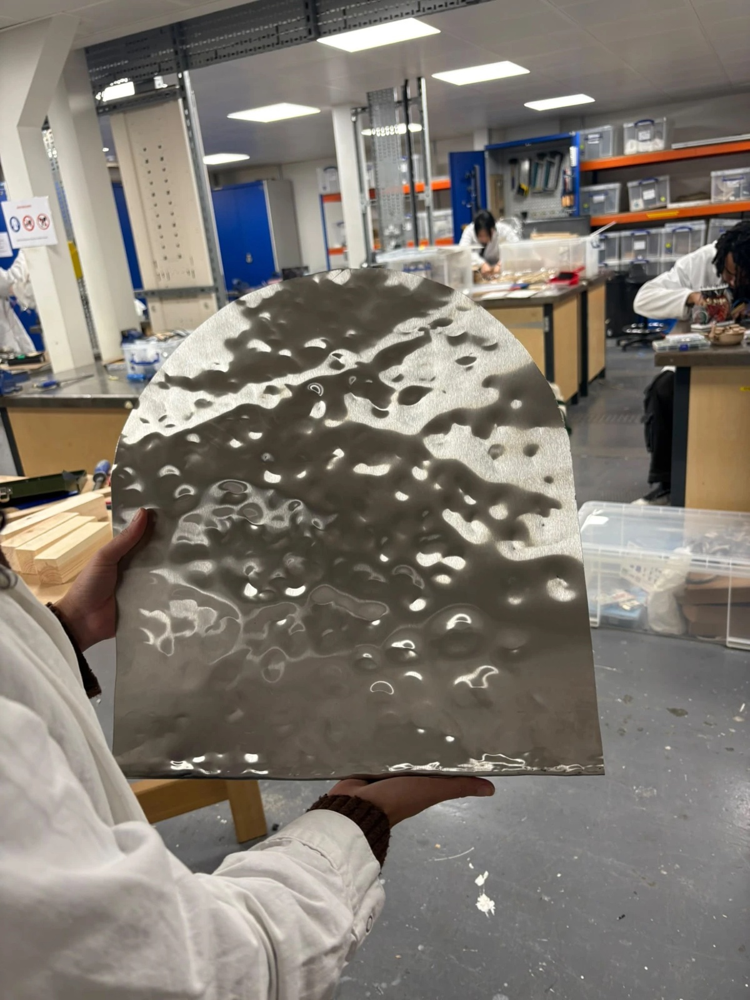

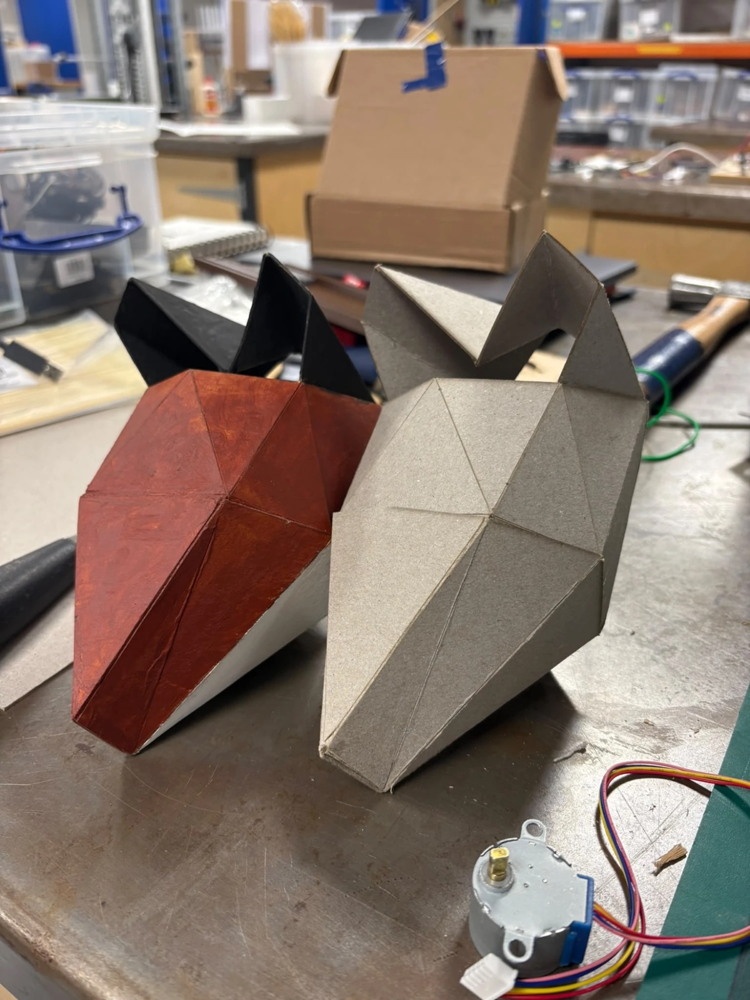

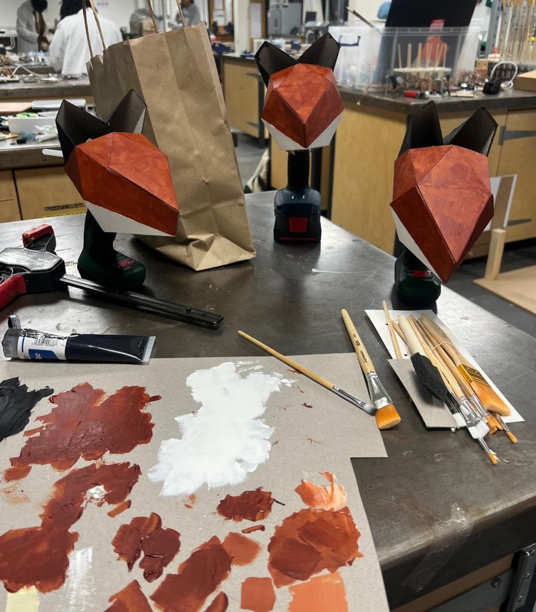

[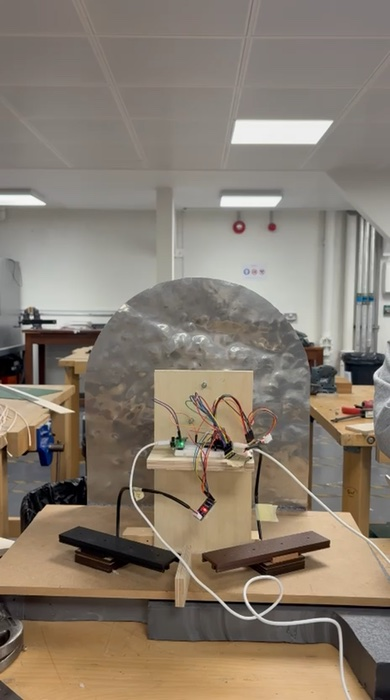](videos/behind-the-plate.mp4)

The mechanism from behind the plate, in action (click to download video).

## Hardware design

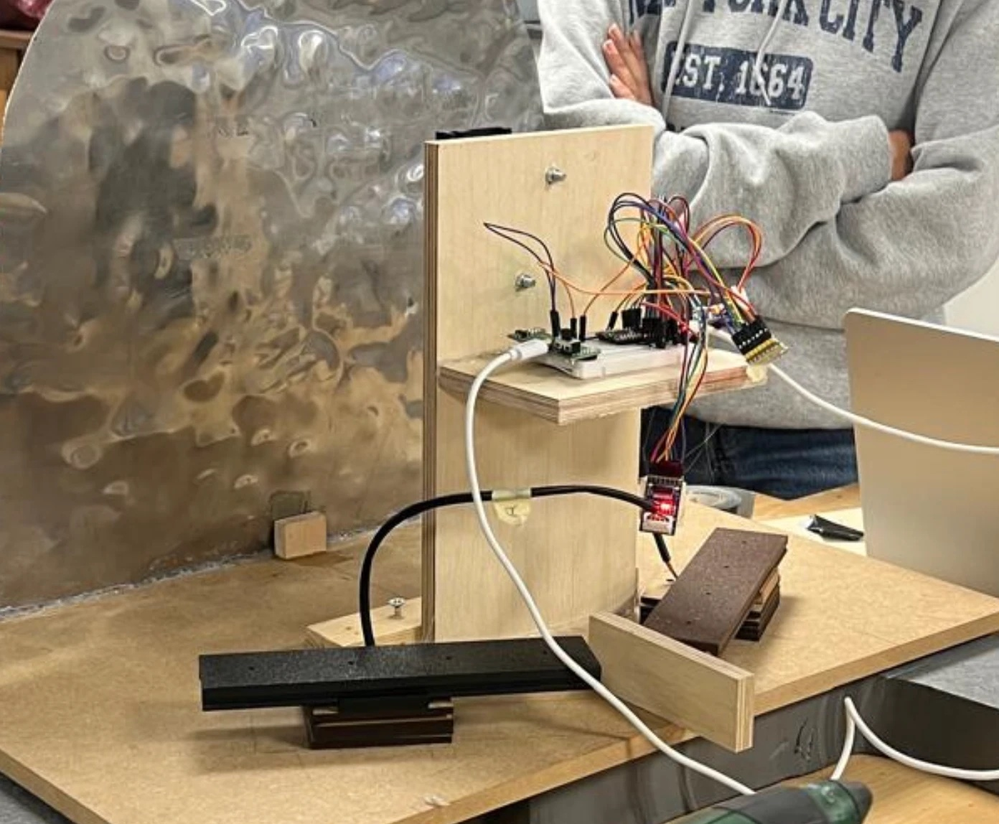

An Arduino Nano Every, connected to the laptop over USB, controls 3 28BYJ-48 stepper motors through Seeed Studio driver boards. The stepper.h library drives each motor with four pins. Everything is wired on a breadboard. The power board at the end of the breadboard supplies 5 V to the top rail, which powers the three drivers, so the motors draw nothing from the Arduino's pins. The Arduino's GND is joined to the rail's GND. The laptop's webcam is the only sensor.

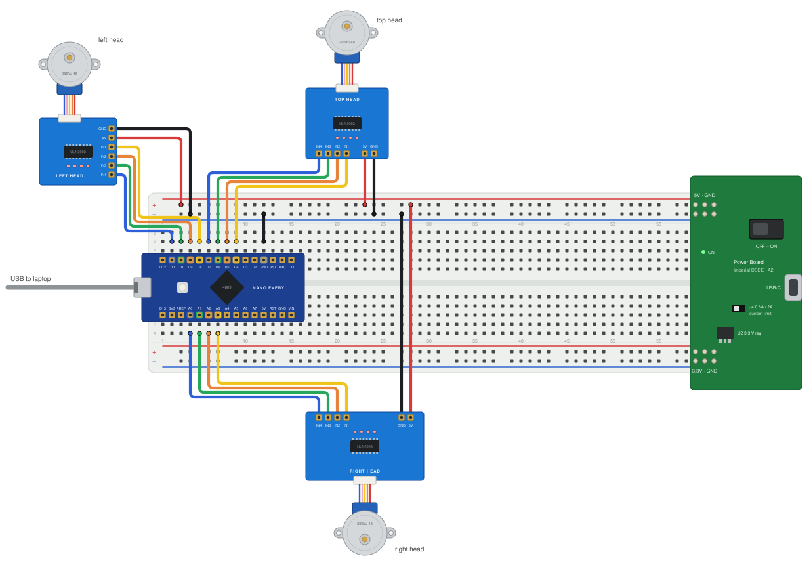

The left head's driver uses pins 8 to 11, the top head's uses 4 to 7 and the right head's uses A0 to A3 (14 to 17). The sketch passes them to Stepper in the order 8, 10, 9, 11 for the left head, 4, 6, 5, 7 for the top and 17, 15, 16, 14 for the right.

[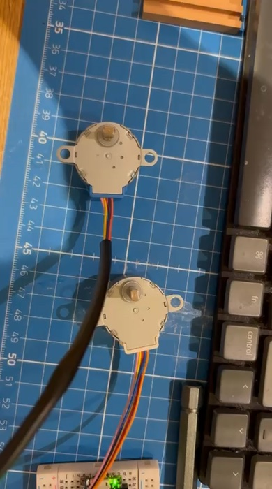](videos/motor-test.mp4)

Bench test of the stepper motors (click to download video).

## Software design

Four programs run in a chain: a Python camera script, Wekinator, a Processing sketch and the Arduino sketch. Everything except the Arduino sketch runs on the laptop.

The camera script (camera/fox_camera.py) tracks the visitor with MediaPipe pose and sends six values to Wekinator over OSC (/wek/inputs, port 6448) every frame: position across the frame from -1 to 1, distance in metres, and how far out and how high each hand is relative to its shoulder.

Distance is estimated from apparent body size. The script uses shoulder width, or shoulder-to-hip length when that is larger (shoulder width shrinks when a person turns sideways), and falls back to the gap between the eyes when the shoulders are out of frame. Pressing c at 1 m calibrates it for a new camera. All values are smoothed. If a nearby visitor disappears, they have most likely stepped too close to be tracked, so the last values are held for about 10 seconds and the fox stays hidden. Values must be sent as decimals (3.0, not 3), otherwise Wekinator reads them as 0.

Wekinator runs three classifiers with three classes each and sends the results over OSC (/wek/outputs, port 12000): distance (1 close, 2 middle, 3 far), hands (1 down, 2 out) and side (1 middle, 2 left, 3 right). Classes 1 and 2 of the side model were swapped during training, and the Processing sketch swaps them back.

The Processing sketch (processing/FoxHeadsBridge) waits for the same answer ten times in a row, so a single wrong frame cannot move the fox, then chooses a move and sends one byte to the Arduino over USB serial at 9600 baud. It never sends the same move twice in a row, which stops a held head from cycling. It ignores input for the first 5 seconds because the Arduino resets when the serial port opens.

The Arduino sketch (arduino/three-heads) reads the byte and moves the heads. 1 hides, retracting any head that is held out. 2, 3 and 4 make the left, top or right head peek. 5, 6 and 7 bring that head out and hold it until the next message. The one-head-test and three-heads-test sketches are the ones we used to check the motors on their own.

## Machine learning

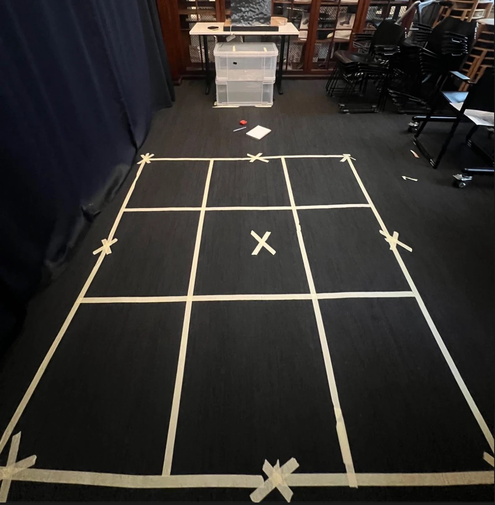

We taped a 3 by 3 grid on the floor in front of the fox, one square per combination of distance and side, and recorded examples standing in each square. The data was recorded in 33 rounds over about an hour, through the same camera script the fox uses live. It is saved in wekinator/fox-robot-project/current/currentData.arff.

The distance model has 3904 labelled examples (1366 close, 1254 middle, 1284 far), the hands model has 2347 (1056 down, 1291 out) and the side model has 5248 (2209 middle, 1754 left, 1285 right).

All three models are k-nearest-neighbour classifiers with k = 1. The six inputs are already meaningful quantities (metres, position across the frame, hand height), so the classes separate cleanly without a more complex model. kNN also trains instantly, which mattered because every change to the camera or calibration meant recording and training again. Splitting the task into three small models let us test distance, hands and side independently.

All the data comes from one session, so different lighting, clothing or camera position could shift the inputs. More people and more rooms would make the models more robust (We are all quite short, so our training is biased towards shorter people). A regression model for distance would let the fox emerge gradually instead of in three steps, and a model that takes movement over time into account could tell someone rushing at the fox from someone approaching slowly.

## First mechanical build

Initially, we’d sought to keep the mechanism to one fox head. This required an actuated pendulum for the head to appear and disappear laterally, as well as linear actuation for the head to appear and disappear vertically. Both linear and rotational motion would be actuated via stepper motor. A stepper motor was used because our system needed continuous precise motion.

For the pendulum, a laser-cut, suspended MDF tower was supported on a square metal rod which acted as the pivoting point for the tower. On one end, the metal rod was secured to the stepper motor via set screw. On the other end, a bearing was used. Both the stepper motor and the bearing were secured to opposite facing walls in the housing that supported the structure.

For the linear actuation, we designed a pulley system within the suspended MDF tower, using a GT2 timing belt. The fox head was then clamped to the timing belt using a supporting rod.

This mechanism design when tested with a stepper motor had issues with the pivoting mechanism as a result of the torque experienced by the motor. Some testing was done to reduce torque and assist the motor with movement using components like springs and counterweights. Preliminary testing revealed further development may require more time than switching to a 3 head rack and pinion system that would be simpler for stepper motor actuation. 

The initial design also relied on a stepper motor with a 1:64 gear ratio; switching to a lower torque-yielding mechanism allowed use to use stepper motors with a 1:16 gear ratio, allowing faster movement of the mechanism.

We also developed and tested a “head tilt” mechanism through gravitational force, and further plans were developed for ear actuation, although these were not tested or deployed due to time constraints and our switch to a different production method.


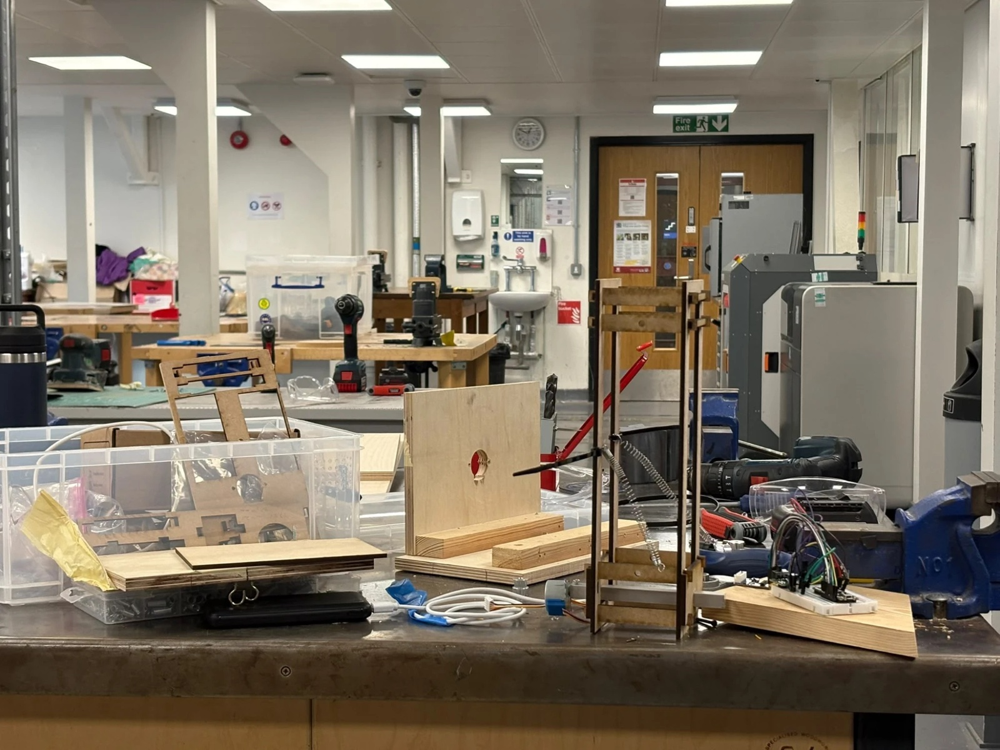

The simulator folder holds a browser simulator we built for this first design. It runs an Arduino sketch against a draggable visitor, and needs an internet connection for the code editor. It does not model the final three-head mechanism.

## How to run it

You need the fox, a webcam, Python 3, Wekinator, Processing with the oscP5 library, and the Arduino IDE.

Install the camera script's dependencies once:

```bash
cd camera
python3 -m venv .venv
source .venv/bin/activate
pip install -r requirements.txt
```

On a Mac, run the script from Terminal and allow Terminal under System Settings > Privacy & Security > Camera.

1. Test the motors. Upload arduino/one-head-test, then arduino/three-heads-test, which cycles through every move. Adjust the step counts in three-heads.ino if a head travels too far or not far enough.
2. Upload arduino/three-heads/three-heads.ino and close the Serial Monitor so Processing can use the port.
3. Open wekinator/fox-robot-project/fox-robot.wekproj in Wekinator and press Run. It should listen on port 6448 with 6 inputs and send 3 outputs to localhost 12000. If the outputs look wrong, press Train first.
4. Run processing/FoxHeadsBridge/FoxHeadsBridge.pde. It finds the Arduino by a port name containing usbmodem or usbserial. Set useArduino = false to run without the board.
5. Start the camera:

```bash
cd camera
source .venv/bin/activate
python3 fox_camera.py
```

Press q to quit. The Processing window shows Wekinator's answer and the fox's current move.

To calibrate distance, stand 1 m from the camera, press c, and paste the two printed values (shoulders1m and eyes1m) into the top of fox_camera.py. Calibrate before training Wekinator. If you calibrate afterwards, train again.

If Processing reports no Arduino, check the cable and the port name. If it cannot open the port, another program is using it, usually the Serial Monitor. If the fox does not move, wait 5 seconds after starting Processing, check Wekinator is running, and hold still long enough for ten matching answers. If the distance is wrong, recalibrate and then retrain. If pose_landmarker_full.task is not found, run the script from inside the camera folder.

## Limitations

The fox follows one person at a time. With two in view it uses whichever MediaPipe detects first. Distance is an estimate that depends on calibration and the camera, and anything nearer than 1 m is reported as 1 m because the model was not trained closer than about 1.1 m. A hand the camera cannot see is treated as down. The fox has three fixed reactions, not a continuous range.

## Repository

The code is in the camera, wekinator, processing and arduino folders. The rack and pinion CAD is in cad, the wiring and mechanism drawings are in diagrams, photos and videos are in images and videos, and the simulator for the first build is in simulator.

## AI use and other acknowledgments

This README was written by a human, and partially formatted / committed with Claude (for ease of reading), and then edited by a human again. Similarly, this was the approach taken to our final code (human written, AI-troubleshooting) :-) Due to time limitations, we also utilised an edited version of a CAD file from @3DStuffGuy on thingiverse.com
